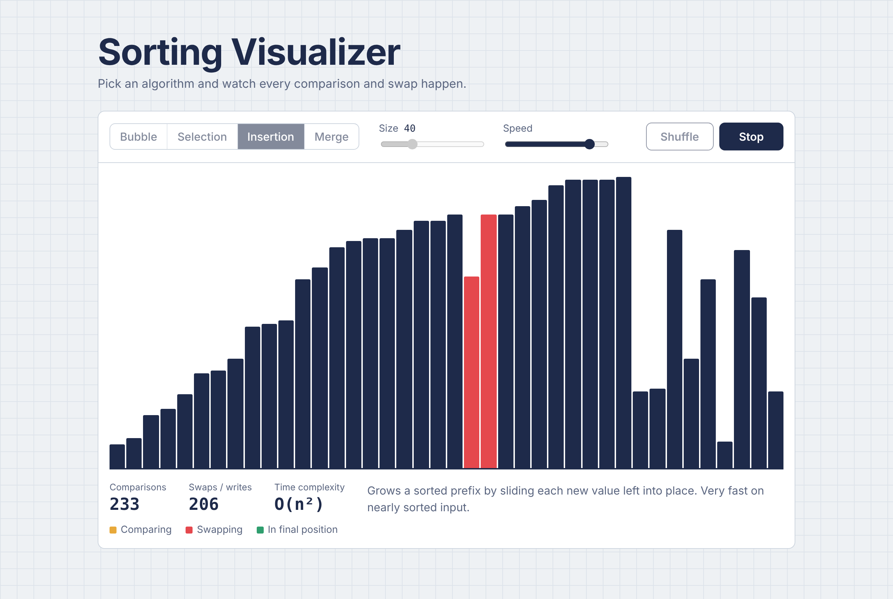

<h1 align="center">Sorting Visualizer</h1>

<p align="center">
  Watch bubble, selection, insertion and merge sort run step by step, with live comparison and swap counts.
</p>

<p align="center">
  <a href="https://bezalelchris.github.io/Data-Structure-Visualizer/"><strong>Live demo</strong></a>
</p>

<p align="center">
  
  
  
  
</p>



## Features

- **Four algorithms:** bubble (with early exit), selection, insertion and merge sort.
- **Live counters** for comparisons and swaps/writes, so you can see *why* O(n²) and O(n log n) feel so different on the same array.
- **Color-coded steps:** amber while comparing, red while swapping, green once a value is in its final position.
- **Stop anytime:** the Sort button becomes Stop mid-run, and controls lock while sorting so runs can't collide.
- **Size 8–120 and adjustable speed,** dark mode, mobile layout, keyboard-accessible controls, and reduced-motion support.

## Try this

Set the size to 120 and run insertion sort, then merge sort. Insertion sort needs thousands of comparisons; merge sort finishes in about 700.

## How it works

Each algorithm is an `async` function that `await`s a short delay after every comparison or swap, which lets the browser repaint between steps. Bar heights are stored as percentages of the array's max value, so the chart scales to any screen width. Stopping sets a flag that the next `compare()` checks, unwinding the sort cleanly.

## Run locally

No build step:

```bash
git clone https://github.com/bezalelchris/Data-Structure-Visualizer.git
cd Data-Structure-Visualizer
open index.html        # or just double-click it
```

## Roadmap

- Quicksort and heap sort
- Step-through mode (one comparison per click)
- Side-by-side race between two algorithms on the same array
